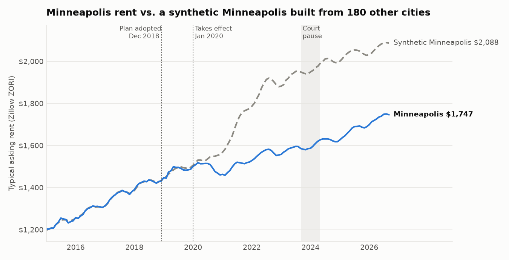

# CityLens: Seeing Where Opportunity Is Growing in America

CityLens looks at every U.S. metro each month through one lens: where are jobs, people, and
income arriving faster than prices are climbing? It finds the places where opportunity is
growing and life is still within reach, before everyone else notices.

It ranks 935 metros on how far a paycheck goes today, detects which affordable metros are
about to grow, and tests what actually works (like zoning reform) to keep cities open to the
people who want to build a life there. It serves two audiences:

- **People** deciding where to start a career, raise a family, or stretch a salary further
- **Businesses** (builders, lenders, employers, investors) deciding where to grow next

## Key findings so far

**Opportunity Index (Layer 2):** 379 U.S. metropolitan areas ranked on affordability, momentum,
and demand. [Full report](docs/opportunity_index_report.md)

- **Top 5:** Huntsville AL, Austin TX, Sherman-Denison TX, Raleigh NC, Sioux Falls SD.
  Huntsville, Austin, Sherman-Denison, and Raleigh stay in the top 25 under 94-99% of
  1,000 random weightings, so the result doesn't depend on the chosen weights.
- **Austin turned a corner:** wages grew about 5% a year since 2023 while home prices fell
  about 5% a year, the biggest paycheck-vs-prices gain of any large metro.
- **Only 62 of 379 metros are both growing and affordable.** Among large metros, the sweet
  spot is concentrated in Texas, plus Raleigh, Oklahoma City, Indianapolis, Columbus,
  Richmond, Birmingham, and Atlanta.
- **The squeeze is coastal:** San Francisco, Boston, Los Angeles, and Santa Barbara rank near
  the bottom, where a mortgage on a typical home takes 39-63% of a typical household's income.

**Rising City Detector (Layer 3):** which metros' home prices will outgrow the typical metro
next year, and do the usual boomtown signals predict it? Panel regression on 2,600+
metro-years, plus a walk-forward backtest. [Full report](docs/rising_cities_report.md)

- **The pandemic boomtown signal flipped.** High migration predicted faster price growth
  through 2021, then turned negative once rates rose in 2022 (clearly so in 2023 and 2024).
- **Simple beat fitted.** A regression trained on past years ranked metros worse out of sample
  than an unfitted blend of momentum and affordability, because it learned a market that stopped
  existing. The blend's top fifth outgrew its bottom fifth by 4.8 points a year on average, and
  never by less than 3.7.
- **The new Rising Cities are in the Midwest and Northeast:** 19 of 24, including Springfield IL,
  Syracuse, South Bend, Cedar Rapids, and four Michigan metros (Saginaw, Monroe, Flint, Battle Creek).
- **55 of 56 Cooling Boomtowns are in the South and West**, 17 of them in Florida, along with
  Austin, Bend, and St. George: pandemic-era magnets where prices have stalled or fallen.
- **The two lists answer different questions.** Austin ranks #2 on the Opportunity Index and is
  also a Cooling Boomtown: falling prices plus strong job growth make it one of the best deals
  for someone moving there now.

**Policy Lab (Layer 4):** did Minneapolis's 2018 decision to end single-family-only zoning slow
rent growth? Published studies disagree (from 17-34% lower to 3-5% higher), so this rebuilds
the test with synthetic control and then tries to break it. [Full report](docs/policy_lab_report.md)



- **The headline replicates:** Minneapolis rents are 16% below a synthetic Minneapolis built from
  180 cities; only 2 of 180 placebo cities show a gap as unusual (p = 0.017).
- **But the gap opened in 2020, not after the 2018 vote**, alongside COVID and the unrest after
  George Floyd's murder.
- **Roughly a third to a half of the gap also shows up in Minneapolis's own suburbs**, which the
  reform didn't cover. That part is regional.
- **Best estimate: the reform explains at most 8-10 points of lower rent.** The 17-34% headline
  overstates it; "no effect" understates it. The home-value gap isn't statistically clear (p = 0.21).

## Roadmap
| Layer | Question it answers | Status |
|---|---|---|
| 1. Data foundation | 7 public sources joined into one tested metro-by-month table | ✅ Done |
| 2. Opportunity Index | Where does a paycheck go furthest today? | ✅ Done |
| 3. Rising City Detector | Which affordable metros are about to grow? | ✅ Done |
| 4. Policy Lab | Did Minneapolis's zoning reform slow rent growth? (synthetic control) | ✅ Done |
| 5. Forecast Engine | Where will rents be in 12 months, with honest uncertainty? | Next |
| 6. Ripple Map | When a metro booms, which neighbors follow? | Planned |
| 7. Decision Tools | Where should a family move, or a builder build? (app + executive memo) | Planned |
| Ops | Monthly automatic refresh with health checks (GitHub Actions) | Planned |

## Data sources
| Source | What it gives | Status |
|---|---|---|
| Zillow Research (ZHVI, ZORI) | Home values and rents by metro and county | ✅ Built |
| FRED | 30-year mortgage rate, CPI | ✅ Built |
| Census metro definitions (2023) | Which counties make up each metro | ✅ Built |
| Census ACS 5-year | Income, renters, rent burden, home values | ✅ Built |
| BLS QCEW | Monthly jobs and weekly wages | ✅ Built |
| Census Building Permits | New housing supply | ✅ Built |
| IRS SOI Migration | Net movers and income by county and metro | ✅ Built |

## Master panel
`pipeline/build_panel.py` runs the SQL models in `sql/` (DuckDB) to build one table:
**every metro × every month since 2015**, with rent, home value, income, jobs, permits,
migration, and mortgage rate side by side, plus affordability ratios. Eight SQL tests in
`sql/tests/` must pass (zero failing rows each). Coverage and a spot check are written to
`docs/panel_report.md`.

## The crosswalk
Every source names places differently. `pipeline/geo.py` matches Zillow's metros to
official Census metro codes two independent ways, then writes a match-rate report to
`docs/crosswalk_report.md`. Hand-checked fixes go in `docs/crosswalk_overrides.csv`.

## Run it
```bash
python -m venv .venv
source .venv/bin/activate        # Windows: .venv\Scripts\activate
pip install -r requirements.txt
cp .env.example .env              # then paste your free API keys
python -m pytest                  # offline tests, no internet needed
python -m pipeline.run_all        # runs every source in order
```
Or run one source at a time: `python -m pipeline.zillow`, `pipeline.fred`, `pipeline.geo`,
`pipeline.census_acs`, `pipeline.qcew`, `pipeline.permits`, `pipeline.migration`, then `pipeline.build_panel`, then `analysis.opportunity_index` and `analysis.rising_cities`, then `pipeline.zillow_city` and `analysis.policy_lab`.

Clean tables land in `data/clean/`. Every run adds a health line to `data/run_log.jsonl`.

## Project structure
```
pipeline/   one script per data source, plus shared config and helpers
tests/      offline tests using small fake data
docs/       decisions log (every judgment call, with the reason)
notebooks/  exploration
app/        Streamlit app (later)
```

## Data notes
- Zillow changes its CSV download paths occasionally. If a download fails, the error
  message explains how to update the link in `pipeline/config.py`.
- See `docs/decisions.md` for every methodology choice.

*Data: Zillow Research, Federal Reserve Bank of St. Louis (FRED), U.S. Census Bureau,
Bureau of Labor Statistics, IRS Statistics of Income.*
