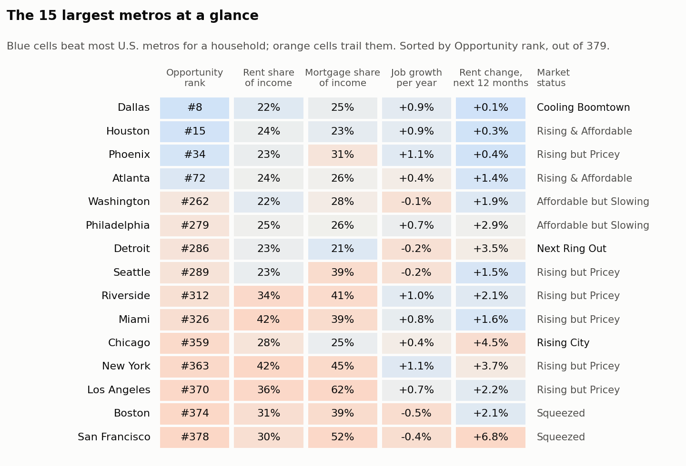
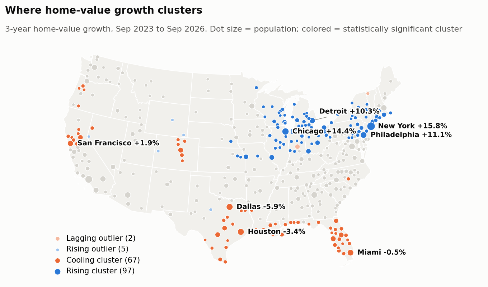

# CityLens

**Where opportunity is growing in America.**

CityLens ranks 379 U.S. metropolitan areas on how far a typical paycheck goes, identifies
where home prices are likely to rise or cool next, forecasts rents a year ahead with tested
uncertainty ranges, and measures what housing policy actually does. It is built from seven
public data sources, rebuilt from the original publishers with one command, and checked by
66 automated tests.

Housing data through September 2026. The [one-page executive memo](docs/executive_memo.md)
has the full summary.



## Findings

**1. Only 62 of 379 metros are both affordable and growing.** Huntsville, Austin,
Sherman-Denison, Raleigh and Sioux Falls lead the Opportunity Index, and the top four stay in
the top 25 under 94 to 99 percent of 1,000 alternative weightings. Among large metros, the
group that is both affordable and growing is Austin, Raleigh, Dallas, San Antonio, Houston,
Oklahoma City, Indianapolis and Columbus. In San Francisco, Los Angeles and Boston, a mortgage
on a typical home takes 39 to 62 percent of a typical household's income.
[Report](docs/opportunity_index_report.md)

**2. Price growth has moved north.** Of the 24 metros most likely to outgrow the national
market next year, 19 are in the Midwest or Northeast. Of the 56 cooling boomtowns, 55 are in
the South and West, 17 of them in Florida. Metros gaining residents saw faster price growth
through 2021 and slower growth from 2022 on, so a model trained on the pandemic years ranks
metros worse than a simple two-signal rule. [Report](docs/rising_cities_report.md)

**3. Growth spreads about 75 miles.** Faster growth among neighbors within 75 miles adds
0.45 points to a metro's growth the following year (per standard deviation), beyond its own
momentum, and the effect held before, during and after the pandemic. Twenty-six affordable
metros have neighbors pulling ahead of them, including Eau Claire, Fargo, Fort Wayne and
Davenport. [Report](docs/ripple_map_report.md)



**4. Rent in a typical metro is forecast to rise about 3 percent over the next year.** The
slowest growth among large metros is expected in Austin, Dallas, San Antonio and Orlando. In
backtests over 2020 to 2025, the forecasts missed by 3.1 points of 12-month growth against
3.5 for the best simple rule, and by 1.8 against 2.7 since 2022. Their 80 percent ranges held
94 percent of outcomes since 2022. [Report](docs/forecast_report.md)

**5. Zoning reform lowered Minneapolis rents, but by less than reported.** Minneapolis rents
are 16 percent below a synthetic Minneapolis built from 180 cities (p = 0.017), but the gap
opened in 2020, not after the 2018 vote, and Minneapolis's own suburbs fell about 8 percent
as well. The reform explains at most 8 to 10 points of lower rent. [Report](docs/policy_lab_report.md)

## Use it

The decision app has a tool for households (enter an income and a rent-or-buy choice, see
which metros fit and what is left over each month) and a tool for builders and lenders (weight
the signals that matter and get ranked markets), plus a profile for every metro.

```bash
streamlit run app/streamlit_app.py
```

## How it is built

| Stage | What it does | Where |
|---|---|---|
| Ingest | Pulls Zillow, Census ACS, Census building permits, BLS QCEW, IRS migration, FRED and Census geography; validates each source and logs every run | `pipeline/` |
| Crosswalk | Matches Zillow metros to official Census metros two independent ways (97.7% matched); manual fixes kept in a reviewed file | `pipeline/geo.py` |
| Panel | Builds one table of 935 metros by month since 2015 in SQL (DuckDB), with 8 data tests that fail the build on a bad join | `sql/` |
| Opportunity Index | Percentile-based index of affordability, momentum and demand, with 1,000-weighting and drop-one sensitivity tests | `analysis/opportunity_index.py` |
| Rising City Detector | Panel regression with year fixed effects and clustered errors, year-by-year estimates and a walk-forward backtest of six designs | `analysis/rising_cities.py` |
| Policy Lab | Synthetic control of Minneapolis's 2040 Plan with placebo tests in space and time, leave-one-out and same-market comparisons | `analysis/policy_lab.py` |
| Forecast Engine | Gradient-boosted forecasts blended with a national-trend model, a rolling-origin backtest against three baselines, and conformal 80% ranges | `analysis/forecast_engine.py` |
| Ripple Map | Global and local Moran's I, distance-ring spillover regression and a U.S. cluster map | `analysis/ripple_map.py` |
| Scorecard | Joins every analysis into one row per metro for the memo and the app | `analysis/scorecard.py` |

Every judgment call, from which home-value series to use to why a fitted model was rejected,
is recorded with its reason in the [decisions log](docs/decisions.md).

## Run it

```bash
python -m venv .venv
source .venv/bin/activate          # Windows: .venv\Scripts\activate
pip install -r requirements.txt
cp .env.example .env               # add free Census, BLS and FRED API keys
python -m pytest                   # offline tests, no data or keys needed
python -m pipeline.run_all         # downloads every source and rebuilds every analysis
streamlit run app/streamlit_app.py
```

## Data sources

- [Zillow Research](https://www.zillow.com/research/data/): home values (ZHVI) and rents (ZORI) by metro, county and city
- [Census American Community Survey](https://www.census.gov/programs-surveys/acs): income, renters and rent burden
- [Census Building Permits Survey](https://www.census.gov/construction/bps/): new housing units authorized
- [BLS Quarterly Census of Employment and Wages](https://www.bls.gov/cew/): jobs and wages by county
- [IRS Statistics of Income migration data](https://www.irs.gov/statistics/soi-tax-stats-migration-data): moves between counties
- [Federal Reserve Economic Data](https://fred.stlouisfed.org/): 30-year mortgage rate and consumer prices
- [Census metro definitions, Gazetteer and boundary files](https://www.census.gov/geographies/reference-files.html): which counties form each metro, coordinates and state outlines

## Known limits and next steps

- The panel covers all 935 Census metro and micropolitan areas, but only metropolitan areas are ranked.
  Of 393, Puerto Rico (6, no Zillow data), Connecticut (5, see below) and 3 metros created in the 2023 Census
  update without Zillow series yet are left out, which gives 379.
- Connecticut metros are not ranked yet. BLS moved Connecticut from counties to planning regions
  in 2024, so job growth can't be compared across the change. A county-to-region crosswalk is next.
- Migration data runs two years behind and job data about six months behind.
- The Rising City and ripple signals predict well but do not prove cause and effect.
- Planned: an automatic monthly refresh, and drive-time instead of straight-line distance in the Ripple Map.

## Author

Likhith Yedida. [LinkedIn](https://www.linkedin.com/in/likhithyedida) | [GitHub](https://github.com/LikhithYedida)
