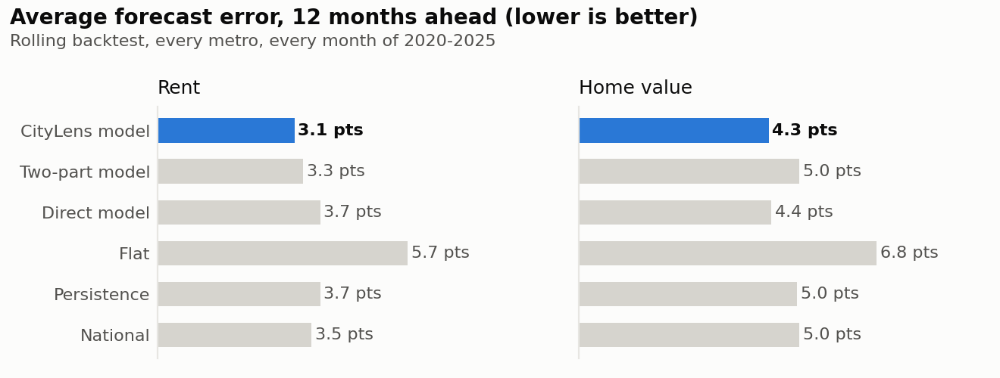
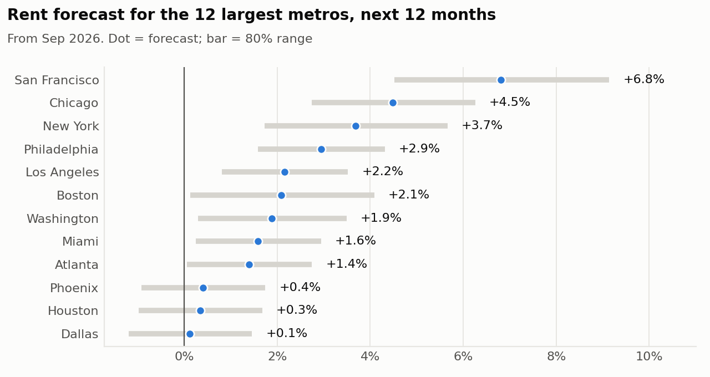

# CityLens Forecast Engine

**Question:** where will rents and home values be 12 months from now, and how sure can we be?

## Short answer

1. **Over 2020-2025 the rent forecast missed by 3.1 points** of 12-month growth on average, vs. 3.5 for the best simple baseline (national): 11% smaller errors. **Since 2022 the gap is 34%** (1.8 vs. 2.7).
2. **No model saw the pandemic coming.** In 2020-21 every approach missed badly; most of any forecast's error is the national swing, which local data can't predict. Two designs fail in different years (one missed the 2021 surge, the other the 2022 turn), so the CityLens forecast averages them.
3. **The ranges are honest about it.** 94% of outcomes landed inside the 80% ranges in 2022-2025, and 72% across all years including the pandemic shock.
4. **Forecast from Sep 2026:** typical metro rent +3.1% over the next 12 months.

## Backtest, year by year

Average miss in percentage points of 12-month growth. The model is trained only on outcomes known by January of each test year.

**Rent**

| Test year | CityLens model | Two-part | Direct | Flat | Persistence | National | 80% range coverage |
|---|---|---|---|---|---|---|---|
| 2020 | 5.7 | **5.7** | 5.8 | 9.5 | 5.7 | 5.8 | 21% |
| 2021 | 6.4 | 5.1 | 8.9 | 10.4 | 5.3 | **4.7** | 24% |
| 2022 | **2.4** | 4.8 | 3.5 | 4.9 | 6.0 | 5.6 | 99% |
| 2023 | **1.8** | 1.9 | 1.8 | 3.9 | 2.4 | 2.1 | 100% |
| 2024 | 1.5 | **1.5** | 1.6 | 3.4 | 1.8 | 1.7 | 95% |
| 2025 | 1.6 | **1.6** | 1.6 | 3.2 | 1.8 | 1.8 | 81% |
| All years | **3.1** | 3.3 | 3.7 | 5.7 | 3.7 | 3.5 | 72% |
| 2022-2025 | **1.8** | 2.4 | 2.1 | 3.8 | 2.9 | 2.7 | 94% |

**Home value**

| Test year | CityLens model | Two-part | Direct | Flat | Persistence | National | 80% range coverage |
|---|---|---|---|---|---|---|---|
| 2020 | 7.4 | **6.8** | 8.0 | 13.2 | 7.3 | 7.3 | 21% |
| 2021 | **4.0** | 4.9 | 5.7 | 12.5 | 4.6 | 4.8 | 82% |
| 2022 | 7.2 | 10.7 | **4.1** | 4.3 | 9.6 | 9.5 | 99% |
| 2023 | **2.4** | 2.5 | 2.9 | 4.1 | 3.0 | 2.7 | 100% |
| 2024 | 2.6 | **2.2** | 3.1 | 3.0 | 2.7 | 2.7 | 95% |
| 2025 | **1.9** | 2.6 | 1.9 | 2.7 | 2.0 | 2.4 | 88% |
| All years | **4.3** | 5.0 | 4.4 | 6.8 | 5.0 | 5.0 | 81% |
| 2022-2025 | 3.6 | 4.6 | **3.1** | 3.6 | 4.5 | 4.5 | 96% |

Bold = most accurate that year. Design history, in order: the direct model came first; its 2021 miss and the finding that most error is the national swing led to the two-part model; that model's 2022 miss led to averaging the two. Because these choices were made while looking at this backtest, the forecasts made from here on are the true out-of-sample test.

## Rent forecast for the 12 largest metros

## Fastest expected rent growth (next 12 months)

| Metro | Rent now | Last 12 months | Forecast | 80% range |
|---|---|---|---|---|
| Lake Charles, LA | $1,358 | +18.9% | **+11.5%** | +7.4% to +15.9% |
| Cedar Rapids, IA | $1,226 | +14.1% | **+9.5%** | +6.2% to +12.9% |
| Sandusky, OH | $1,812 | +11.1% | **+7.4%** | +0.1% to +15.2% |
| Charleston, WV | $1,210 | +3.3% | **+7.2%** | +5.2% to +9.2% |
| San Francisco-Oakland-Fremont, CA | $3,445 | +11.8% | **+6.8%** | +4.5% to +9.1% |
| Lima, OH | $1,208 | +3.8% | **+6.6%** | -1.7% to +15.7% |
| Houma-Bayou Cane-Thibodaux, LA | $1,302 | +5.8% | **+6.4%** | +4.0% to +8.8% |
| Wausau, WI | $960 | +6.4% | **+6.1%** | +2.7% to +9.5% |
| Battle Creek, MI | $1,146 | +3.7% | **+6.0%** | +3.7% to +8.4% |
| Beckley, WV | $1,041 | +6.9% | **+5.8%** | -2.0% to +14.3% |

## Slowest expected rent growth (next 12 months)

| Metro | Rent now | Last 12 months | Forecast | 80% range |
|---|---|---|---|---|
| North Port-Bradenton-Sarasota, FL | $2,106 | +0.1% | **-1.8%** | -3.1% to -0.5% |
| Cape Coral-Fort Myers, FL | $1,827 | -0.1% | **-0.6%** | -2.0% to +0.8% |
| Austin-Round Rock-San Marcos, TX | $1,603 | +0.7% | **-0.2%** | -2.0% to +1.7% |
| Wildwood-The Villages, FL | $1,723 | +2.6% | **-0.1%** | -3.9% to +3.9% |
| Dallas-Fort Worth-Arlington, TX | $1,659 | +0.7% | **+0.1%** | -1.2% to +1.5% |
| San Antonio-New Braunfels, TX | $1,415 | -0.7% | **+0.2%** | -1.4% to +1.8% |
| Orlando-Kissimmee-Sanford, FL | $1,929 | +0.8% | **+0.3%** | -1.1% to +1.7% |
| Houston-Pasadena-The Woodlands, TX | $1,638 | +0.1% | **+0.3%** | -1.0% to +1.7% |
| Myrtle Beach-Conway-North Myrtle Beach, SC | $1,722 | +2.3% | **+0.4%** | -1.8% to +2.6% |
| Phoenix-Mesa-Chandler, AZ | $1,720 | +1.0% | **+0.4%** | -0.9% to +1.7% |

## What drives the forecast

Permutation importance on the 2025 test year: how much worse the metro adjustment gets (points of error) when each input is scrambled.

| Input | Added error when scrambled |
|---|---|
| New homes permitted | +0.12 pts |
| Other housing cost, last 12 months | +0.11 pts |
| Metro size | +0.07 pts |
| Price change, last 3 months | +0.03 pts |
| Metro vs. national trend | +0.02 pts |
| Price change, last 24 months | +0.02 pts |
| Price change, last 12 months | +0.01 pts |
| How much prices swing | +0.01 pts |

## Home values

Typical metro home value forecast: +1.6% over the next 12 months. Backtest error 4.3 pts (3.6 since 2022) vs. 5.0 for the best baseline; range coverage 81%.

## How it works

- **Model:** the average of (a) the latest national 12-month trend plus a metro adjustment and (b) a direct forecast of total growth. Both are gradient-boosted trees (scikit-learn), one model across all metros; the adjustment model learns each metro's 12-month change relative to the national average that month.
- **Inputs** are lagged to match publication: jobs 6 months, incomes 12, permits 18, migration 24.
- **Backtest:** for each year 2020-2025, train on outcomes known by January, forecast every metro for every month of that year.
- **80% ranges:** normalized split conformal prediction. A model trained two years earlier is scored on the 24 months before the cutoff; its errors, scaled by each metro's price volatility, set the range width.

## Caveats

- 2020-2022 were unusually hard to forecast (pandemic boom, then rate shock); errors in calmer years are much smaller.
- Forecasts assume the next year looks like the recent past. A sudden shock (a recession, a rate cut cycle) would push outcomes outside the ranges.
- Zillow's rent index covers asking rents on new leases.
