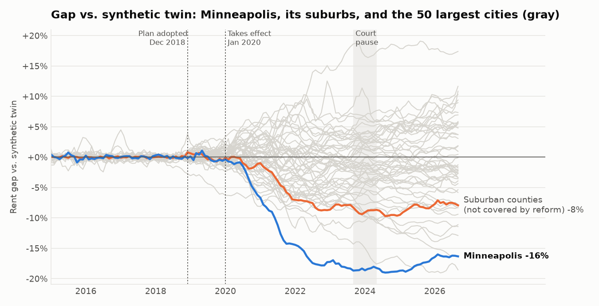

# CityLens Policy Lab: Did Minneapolis's zoning reform slow rent growth?

In December 2018, Minneapolis adopted its 2040 Plan, becoming the first major U.S. city to end single-family-only zoning. Researchers disagree about what it did:

| Study | Method | Finding |
|---|---|---|
| [Gu & Munro (Middlebury), 2025](https://marginalrevolution.com/marginalrevolution/2025/08/did-the-minnesota-housing-reform-lower-housing-costs.html) | Synthetic control | Rents and home prices 17-34% lower after 5 years |
| [Iowa State, 2021](https://citythatworks.substack.com/p/housing-lessons-from-minneapolis) | Difference-in-differences | Home prices 3-5% higher |
| [Federal Reserve Bank of Minneapolis, 2024](https://www.minneapolisfed.org/article/2024/minneapolis-2040-plan-data-tool-prepared-to-measure-impacts) | Data through 2022 | No significant change |

This analysis rebuilds the test transparently, then tries to find out *why* the answers differ.

## Short answer

1. **The headline rent effect replicates.** Minneapolis rents ended up **16% below** a synthetic Minneapolis built from 180 other cities (largest gap 19%), and only 2 of 180 placebo cities show a gap as unusual (p = 0.017).
2. **But the gap didn't open when the reform passed.** It was -0.6% at the end of 2019 and only opened in 2020-21, the same time as COVID and the unrest after George Floyd's murder.
3. **Roughly 34%-49% of the gap also appears in Minneapolis's suburbs**, which the reform did not cover (suburban counties -7.9% vs. Minneapolis -16.3%). That part is regional, not the reform. Single suburbs vary more widely (see below), as small cities are noisier.
4. **Best estimate: the reform explains at most about 8-10 percentage points** of lower rent (the gap beyond the suburbs), and even that overlaps with 2020 shocks that hit the core city harder than its suburbs. The 17-34% headline overstates it; 'no effect' understates it.
5. **Home values don't pass the significance test.** Their gap (-15.8%) is matched by many placebo cities (p = 0.21), so only the rent result is statistically clear.

## How the test was built

- **Treated city:** Minneapolis. **Outcome:** Zillow's typical asking rent (ZORI), monthly, Jan 2015 to Sep 2026.
- **Donor pool:** 180 of the 300 largest U.S. cities with complete data, excluding cities that had their own zoning reforms or share Minneapolis's market:

| Excluded | Reason |
|---|---|
| All MN cities | Same housing market as Minneapolis (spillovers) |
| All CA cities | Statewide ADU and lot-split laws (2017-2022) |
| All OR cities | Statewide middle-housing law (HB 2001, 2019) |
| Seattle, WA | Accessory-dwelling reform (2019) |
| Raleigh, NC | Missing-middle zoning reform (2021) |
| Spokane, WA | Interim citywide upzoning (2022) |
| Arlington, VA | Missing-middle zoning reform (2023) |
| Austin, TX | HOME zoning reform (2023) |
| Cambridge, MA | Citywide multifamily upzoning (2025) |

- **Method:** demeaned synthetic control (weights ≥ 0, summing to 1) fit on December 2018 and earlier. Pre-reform fit error: **0.28%** a month, so the twin tracked Minneapolis closely.
- **Synthetic Minneapolis is made of:** Saint Augustine, FL (22%), Bellevue, WA (20%), Tacoma, WA (13%), Mesquite, TX (10%), Albany, NY (9%), Mobile, AL (6%), Allentown, PA (5%), Ann Arbor, MI (5%), Decatur, GA (5%).

## Trying to break the result

| Date | Minneapolis | Typical large city | Peer cities with a bigger drop | Suburbs | St. Paul |
|---|---|---|---|---|---|
| Dec 2019 | **-0.6%** | -0.1% | 12 of 50 | -0.5% | -0.2% |
| Dec 2020 | **-6.2%** | -0.4% | 3 of 50 | -1.1% | -2.8% |
| Dec 2021 | **-14.3%** | -0.8% | 0 of 50 | -7.0% | -10.2% |
| Dec 2022 | **-17.3%** | -1.0% | 0 of 50 | -8.7% | -13.7% |
| Dec 2024 | **-18.8%** | -0.6% | 0 of 50 | -9.6% | -14.8% |
| Sep 2026 | **-16.3%** | -1.7% | 1 of 50 | -7.9% | -14.1% |

- **Placebo in space:** Minneapolis's post/pre fit-error ratio ranks 3 of 181 (p = 0.017). The gap is unusual.
- **Peers:** the typical large city ended -1.7% vs. its own twin; 1 of 50 fell further than Minneapolis. Not a generic big-city COVID dip.
- **Placebo in time:** pretending the reform happened in January 2017 (using only pre-2019 data) gives a gap of +2.0% by late 2018. No false effect before the real reform.
- **Effective date instead of adoption date** (January 2020): latest gap -15.5%. Same answer.
- **Leave-one-out:** dropping each of the five biggest donor cities in turn:

| Donor dropped | Its weight | Latest gap without it |
|---|---|---|
| Saint Augustine, FL | 22% | -16.9% |
| Bellevue, WA | 20% | -15.0% |
| Tacoma, WA | 13% | -15.9% |
| Mesquite, TX | 10% | -16.5% |
| Albany, NY | 9% | -16.6% |

- **Same market:** Minneapolis's suburbs were not covered by the reform, yet their rents also fell well below their synthetic twin. Each definition is compared with a Minneapolis run that starts on the same date:

| Suburbs defined as | Data from | Pre-fit error | Suburbs gap | Minneapolis gap | Regional share | Minneapolis beyond suburbs |
|---|---|---|---|---|---|---|
| Suburban counties (Anoka, Dakota, Scott, Washington) | 2015 | 0.11% | -7.9% | -16.3% | 49% | -8.4 pp |
| Suburban cities composite (4) | 2016 | 0.18% | -5.3% | -15.5% | 34% | -10.2 pp |
| Bloomington, MN | 2016 | 0.77% | -15.3% | -15.5% | 99% | -0.2 pp |
| Plymouth, MN | 2016 | 0.32% | -9.1% | -15.5% | 59% | -6.4 pp |
| Woodbury, MN | 2016 | 0.60% | -4.6% | -15.5% | 30% | -10.8 pp |
| Eden Prairie, MN | 2016 | 0.54% | -3.1% | -15.5% | 20% | -12.4 pp |

- **St. Paul** fell too, but it passed strict rent control in 2021, so it isn't a clean comparison.

## Home values (secondary outcome)

Minneapolis home values (Zillow ZHVI) ended **-15.8%** vs. their synthetic twin, but 46 of 228 placebo cities show a gap as unusual (p = 0.205), so this is not statistically distinguishable from normal city-to-city variation; the suburban counties ended -6.6%.

## What this means

The reform probably did contribute to Minneapolis's unusually soft rents, but far less than the headline number suggests. A large share of the gap is a Twin Cities-wide pattern, and the gap opened in 2020 rather than after the 2018 vote. Studies that compare Minneapolis only to other cities attribute the regional softening to the reform; comparing it to its own suburbs separates the two.

## Caveats

- ZORI measures asking rents on new leases, not what existing tenants pay.
- The suburb comparison assumes the reform didn't push demand into the suburbs; if it did, the suburb gap understates the reform's effect.
- Zoning effects on supply take years; the 2023-24 court pause interrupted the plan.
- City boundaries are Zillow's; Minneapolis is about a tenth of its metro area.
