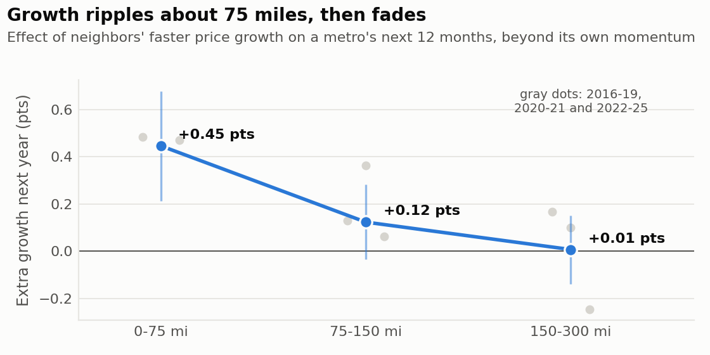
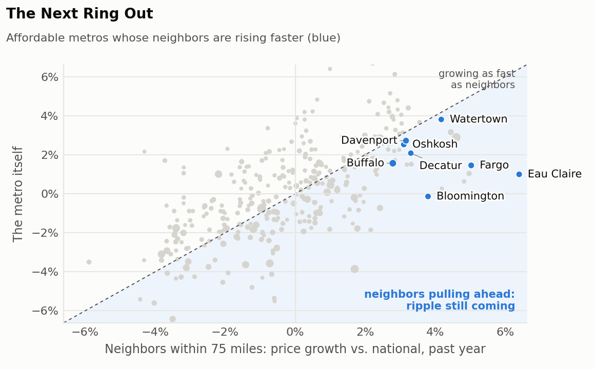

# CityLens Ripple Map

**Question:** when a metro booms, which neighbors follow, and how far does growth spread?

## What we found

- **Growth clusters.** Metros with fast home-value growth sit next to each other far more than chance would allow (Moran's I = 0.69, p = 0.001; 0 would mean no clustering).
- **97 metros form rising clusters**, led by New York, Chicago, Philadelphia, Detroit, St. Louis, Cincinnati, Kansas City, Cleveland. **67 form cooling clusters**, led by Dallas, Houston, Miami, San Francisco, Tampa, Denver, Orlando, San Antonio.
- **Growth ripples about 75 miles.** When neighbors within 75 miles grow faster, a metro grows +0.45 points more the next year per standard deviation, beyond its own momentum (t = 3.8). The effect is +0.48 in 2016-2019, +0.45 in 2020-2021, +0.47 in 2022-2025: steady through every market regime. Beyond 150 miles it disappears.
- **It adds real, modest forecasting value.** Including neighbors improved next-year rankings in **4 of 6 backtest years**.
- **26 affordable metros are in the Next Ring Out**, where neighbors are pulling ahead and the ripple hasn't arrived yet.

## How far the ripple travels

- **0-75 miles:** +0.45 pts (95% range +0.21 to +0.68, t = 3.8)
- **75-150 miles:** +0.12 pts (95% range -0.03 to +0.28, t = 1.5)
- **150-300 miles:** +0.01 pts (95% range -0.14 to +0.15, t = 0.1)
- *For comparison, the metro's own past growth:* +1.17 pts (t = 10.0).

Each effect is the extra growth (percentage points, vs. the national average) over the next 12 months for a one-standard-deviation faster rise among neighbors in that ring over the past 12 months, holding the metro's own past growth fixed. 12,647 metro-quarters; standard errors clustered by metro.

## The Next Ring Out

Top fifth for ripple pressure, neighbors growing faster than the metro itself, and above-median affordability on the Opportunity Index:

1. **Eau Claire, WI**: neighbors +6.4% vs. itself +1.0% over the past year (vs. national), adding about +1.4 pts of expected growth; Opportunity Index #87
1. **Watertown-Fort Drum, NY**: neighbors +4.2% vs. itself +3.8% over the past year (vs. national), adding about +1.1 pts of expected growth; Opportunity Index #341
1. **Fargo, ND-MN**: neighbors +5.0% vs. itself +1.5% over the past year (vs. national), adding about +1.1 pts of expected growth; Opportunity Index #81
1. **Bloomington, IL**: neighbors +3.8% vs. itself -0.1% over the past year (vs. national), adding about +1.0 pts of expected growth; Opportunity Index #236
1. **Oshkosh-Neenah, WI**: neighbors +3.1% vs. itself +2.5% over the past year (vs. national), adding about +0.9 pts of expected growth; Opportunity Index #208
1. **Decatur, IL**: neighbors +3.3% vs. itself +2.1% over the past year (vs. national), adding about +0.9 pts of expected growth; Opportunity Index #309
1. **Davenport-Moline-Rock Island, IA-IL**: neighbors +3.2% vs. itself +2.7% over the past year (vs. national), adding about +0.9 pts of expected growth; Opportunity Index #118
1. **Buffalo-Cheektowaga, NY**: neighbors +2.8% vs. itself +1.6% over the past year (vs. national), adding about +0.9 pts of expected growth; Opportunity Index #302
1. **Fort Wayne, IN**: neighbors +3.3% vs. itself +1.5% over the past year (vs. national), adding about +0.9 pts of expected growth; Opportunity Index #100
1. **Muskegon-Norton Shores, MI**: neighbors +2.8% vs. itself +2.2% over the past year (vs. national), adding about +0.8 pts of expected growth; Opportunity Index #176
1. **Fond du Lac, WI**: neighbors +2.7% vs. itself +2.6% over the past year (vs. national), adding about +0.8 pts of expected growth; Opportunity Index #284
1. **Michigan City-La Porte, IN**: neighbors +3.0% vs. itself +2.2% over the past year (vs. national), adding about +0.8 pts of expected growth; Opportunity Index #271

## Backtest

Rank correlation of next-year growth, model trained only on earlier years: own momentum alone → with neighbor rings.

**2020:** 0.39 → 0.37 · **2021:** 0.43 → 0.44 · **2022:** 0.03 → 0.01 · **2023:** 0.52 → 0.54 · **2024:** 0.60 → 0.63 · **2025:** 0.71 → 0.73

## How it works

- **Clusters:** 3-year home-value growth (Sep 2023 to Sep 2026); each metro's 6 nearest metros as neighbors; global and local Moran's I with 999 permutations; clusters shown at p < 0.05.
- **Ripple:** quarterly panel 2016-2025; rings are population-weighted averages of other metros' growth by great-circle distance; all growth measured against the national average that month.
- **Next Ring Out:** ripple pressure = the ring effects applied to each metro's latest neighbor growth.
- **Map:** Albers equal-area projection; Census state outlines and metro interior points.

## Caveats

- Neighbors may rise together because they share a cause (a regional employer, weather, policy), not because growth literally spreads. The ripple is predictive, not proof of contagion.
- Distance is straight-line; highways and commuting patterns would sharpen the rings.
- Local clusters are tested one metro at a time, so a few may be false positives at p < 0.05.
